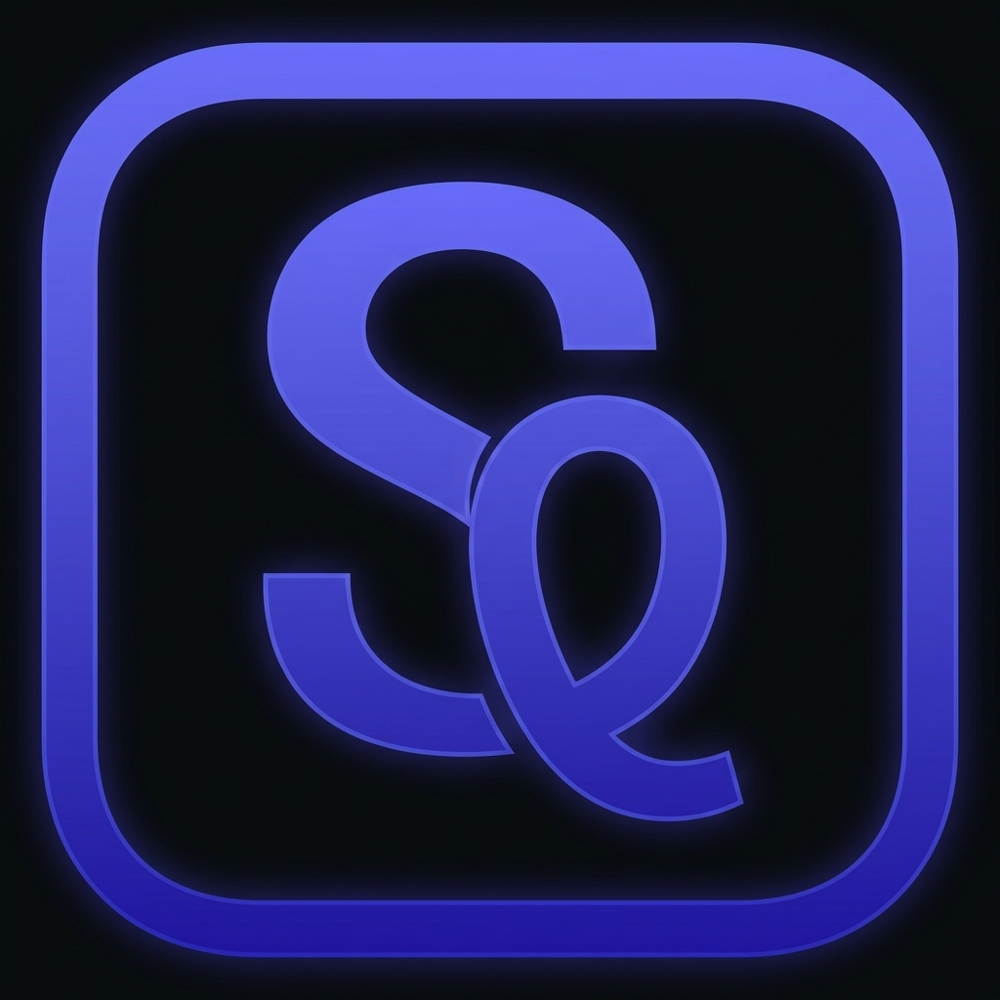

<p align="center">
  
</p>

<h1 align="center">SoloQueue</h1>

<p align="center">
  <a href="README.md">English</a> ·
  <a href="README.zh-CN.md">简体中文</a> ·
  <a href="#documentation">Documentation</a>
</p>

<p align="center">
  <a href="LICENSE"></a>
</p>

SoloQueue is an open-source, local-first AI workspace for personal use. Work with it around your projects to keep conversations going and move tasks forward. It can use files, commands, and external tools to get work done; extend its capabilities with Skills; build long-term memory; and coordinate multiple AI agents on complex tasks.

SoloQueue draws inspiration from OpenClaw and my exploration of multi-agent orchestration and collaboration. After studying and practicing with a range of Agent Harness approaches, I built SoloQueue's core in Go and optimized it for DeepSeek, aiming to balance execution performance, cost, and everyday usability. It is also an ongoing engineering practice in building an Agent Harness.

SoloQueue has been running on my personal computer for a long time. It is lightweight and easy to deploy and extend. Connect a compatible model provider to run it on a personal computer or server, then use the web interface, QQ, WeChat, Telegram, or WeCom to start tasks, track progress, and receive results.

## Quick Start

Building from source requires Go 1.25.8, Node.js, `pnpm`, and Make:

```bash
git clone https://github.com/Fize/soloQueue.git
cd soloQueue

make build
./soloqueue start
```

On Windows x64, build from PowerShell with Go, Node.js and pnpm installed:

```powershell
.\scripts\build-windows.ps1
.\soloqueue.exe start
```

Windows archives built by the release workflow include `silk-decoder.exe`, which must stay next to `soloqueue.exe` for the speech dependency installer. The installer downloads pinned Whisper, FFmpeg and model files into the SoloQueue work directory. For source builds, the installer downloads the decoder when it is not bundled. Windows uses PowerShell for commands; Skills containing Unix shell syntax need a Windows-compatible variant. MCP/LSP batch launchers reject cmd.exe metacharacters (`"`, `&`, `|`, `<`, `>`, `^`, `%`, `!`) in paths and arguments; use a native executable or invoke Node with its JavaScript entry point when those characters are needed. Batch arguments ending in backslashes are quoted for Node-compatible shims; a generic batch file reading `%~1` may observe extra trailing backslashes.

Open <http://127.0.0.1:57689>, configure a model, and add a project directory to get started. You can enter the provider API key in the Web Console.

For other model providers, Docker deployment, and troubleshooting, see the [Getting Started guide](docs/getting-started.md).

## Security

SoloQueue listens on `127.0.0.1` by default. Its tools inherit the system permissions of the SoloQueue process and can read files and run commands. For stronger isolation, running SoloQueue in a container or virtual machine is strongly recommended.

## Documentation

- [Getting Started](docs/getting-started.md)
- [Reference](docs/reference.md)
- [Architecture](docs/architecture.md)
- [Task Routing](docs/routing.md)
- [Agent Execution](docs/agent.md)
- [Context and Memory](docs/context-and-memory.md)

## License

[MIT](LICENSE)
