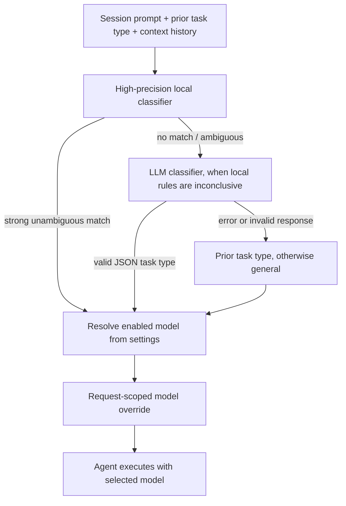

# Task Routing

English | [简体中文](zh/routing.md)

This document describes how the current runtime classifies an interactive request and turns that classification into model parameters. Routing is a model-selection step; it does not itself decide whether work is delegated to another Agent.

## The routing path

The interactive path starts in `Session.AskStream`. The session passes the new prompt, the previous task type, and its current context payload to the router. A successful decision is attached to that request's context as a model override. The Agent then uses the override for the request without changing the model configuration of unrelated requests.

## Task types are not difficulty levels

The classifier returns one of three task types:

| Type | Classification intent |
| --- | --- |
| `general` | Conversation, explanation, writing, translation, or summarization of supplied material. |
| `engineering` | Repository/code work, debugging, tests, databases, APIs, automation, deployment, or technical implementation. |
| `research` | External search, current information, source checking, comparisons, or citation-led work. |

The distinction is about the nature and source of the work, not how difficult it is or how much reasoning it needs. A local code/log investigation is engineering; seeking current external sources is research. Image presence does not create a separate task type.

## How routing evolved

SoloQueue initially explored choosing models by task difficulty. In practice, difficulty was hard to assess consistently and did not map cleanly to the right model. Routing by task type proved closer to everyday use: people tend to choose a model based on whether they are having a general conversation, doing engineering work, or researching external information. SoloQueue therefore classifies requests by task type and lets each type map to its own model.

Semantic classification still uses an LLM: local rules handle clear cases, while ambiguous requests go to the configured classifier model. We will follow JEV's progress and evaluate whether it is suitable for task classification; this remains a future consideration, not a current capability.

## Classification stages

### Local fast-track

`internal/router/fasttrack.go` is intentionally conservative. Strong signals include code blocks, stack traces, and shell/build commands. A file path is strong evidence only when paired with an engineering signal; a technical entity is paired with an action or defect signal. Explicit research or general-language patterns are also recognized.

The local classifier returns a result only when the evidence points clearly to one type. Overlapping signals and weak evidence return “not matched” so they can continue to semantic classification instead of forcing a brittle guess. The result records a source and reason code for observability.

### LLM fallback

When enabled and the local classifier does not decide, `internal/router/llm_classifier.go` sends a bounded request to the configured classifier model. It includes the current prompt, image-presence metadata, and at most six recent user/assistant messages, capped at 4,096 bytes. The classifier request uses a five-second timeout, temperature zero, a small output limit, disabled thinking, and JSON response mode.

Only a valid JSON response containing a supported task type is accepted. Provider errors, malformed JSON, or unsupported values fall back to the previous valid task type; if there is none, the result is `general`. Failures are logged with bounded response diagnostics and do not become the user-facing answer.

## Resolving a model

Classification and model selection are independent. `internal/router/router.go` returns the task type only; the configuration service resolves the one configured default model:

1. `model_routes.default` in `settings.yaml`, when its provider and model are enabled.
2. Otherwise, the first enabled model of the first enabled provider in configuration order.

A reference resolves only when both its provider and model are enabled. An empty or stale `model_routes.default` is treated as an automatic preference rather than a startup error. Conversations, scheduled tasks, and the auxiliary classifier all use that single model; the classifier call forces non-thinking mode. Image transcription uses the active model when it declares `vision: true`, otherwise the first enabled vision-capable model.

A session may override the default. The choice lives in the session's `meta.json` (`model`), so it survives restarts and applies to every entry point sharing that session: Web Console, QQ, WeChat, WeCom, and Telegram. Precedence is session selection → valid `model_routes.default` → first enabled model of the first enabled provider. A selection whose provider or model was later disabled or deleted degrades to the resolved default and logs a warning instead of failing the turn. Channel bridges expose `/model` to show or change it (`/model <provider:model> [low|high|max]`, `/model auto`); the Web Console writes the same state through `PUT /api/session/model` for L1 and `PUT /api/session/l2/{id}/model` for L2. Auxiliary work (compaction, summaries, persona reflection, memory extraction) and scheduled tasks always use the resolved default.

Deleting a provider does not block on model usage. The provider and every model owned by it are removed in one configuration write, and the next request uses the fallback resolution above. Deleting the default model or provider does not rewrite `model_routes.default`; the stale preference is ignored while it cannot resolve.

The task type travels as a label: it is stored for follow-up continuity, written to usage metrics, and published with the request events, but it never selects a model. `RouteDecision` no longer exists.

If classification fails, the session logs the error and continues without a task label; the turn still runs on the default model. If no enabled model resolves at startup, the runtime build fails instead of starting without a model.

## Runtime wiring and state

- `internal/runtime/build_agent.go` builds the default classifier and router from the current settings and LLM client.
- `internal/session/session.go` owns per-request classification, request-scoped model overrides, and previous-task continuity.
- Route state is kept with the live session. For persisted L2 sessions, the last task type is also merged into session metadata so a restart can retain follow-up context.
- Classifier provider/model changes can be applied through the router's update method without rebuilding the classifier abstraction.

Useful implementation and regression-test locations: [`internal/router`](../internal/router), [`internal/tasktype`](../internal/tasktype), [`internal/config`](../internal/config), and [`internal/session`](../internal/session).
